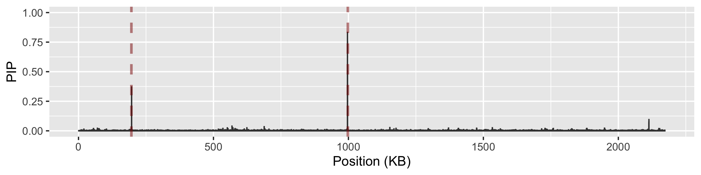
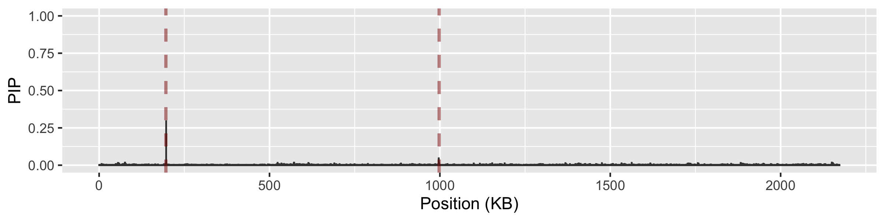
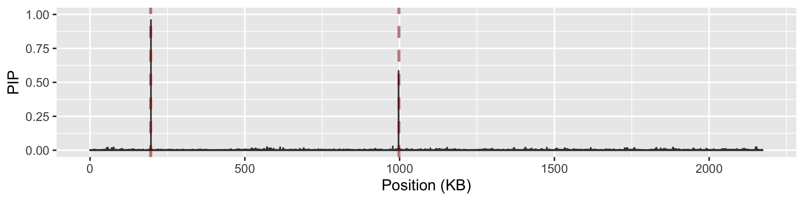
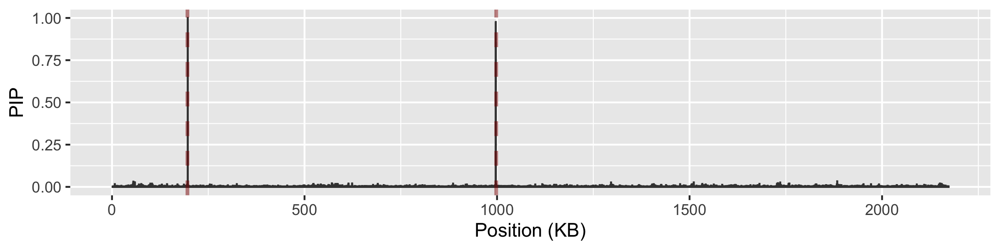

-   [Introduction](#introduction)
-   [Input Data](#input-data)
    -   [Note on Input Types](#note-on-input-types)
    -   [Inspecting the input data](#inspecting-the-input-data)
    -   [Preparing the inputs](#preparing-the-inputs)
    -   [Observations file](#observations-file)
-   [GWAS](#gwas)
    -   [`bassgwass-run.jl` usage](#bassgwass-run.jl-usage)
    -   [Running GWAS on a toy dataset](#running-gwas-on-a-toy-dataset)
    -   [Identifying associations](#identifying-associations)
-   [Adaptive experimental design](#adaptive-experimental-design)
    -   [Setup](#setup)
    -   [Adaptive design](#adaptive-design)
    -   [Additional functionality](#additional-functionality)
-   [Tips](#tips)

First we load the necessary libraries used in this tutorial

    library(ape)
    library(tidyverse)
    library(ggplot2)

    set.seed(1)

**NOTICE: RE-RUNNING THIS TUTORIAL REQUIRES ~16GB OF RAM AND 4 CPU
CORES**

**EXPECTED EXECUTION TIME: ~25-45MIN**

# Introduction

This tutorial assumes that you have previously downloaded the files in
this repository. The first section of the tutorial covers the general
usage of the GWAS model. The second section covers adaptive experimental
design.

Throughout this tutorial we will be using the toy data found in the
`sample_data` folder. This is a version of the ciprofloxacin resistance
benchmark dataset used in the manuscript modified to contain only 20,000
unique variants. The toy dataset uses *unitigs* to characterise genetic
variation.

# Input Data

Using BASS-GWAS requires two main data files: a variant presence-absence
file, and a phylogeny file in the newick format. Both the phylogeny and
variant presence-absence should be constructed for the entire collection
at hand. The first column of the variant file should contain unique
variant identifiers. The remaining columns should each correspond to an
isolate, and the first row contain unique isolate identifiers:

<table>
<thead>
<tr>
<th>variant</th>
<th>isolate_1</th>
<th>isolate_2</th>
<th>isolate_3</th>
<th>…</th>
<th>isolate_n</th>
</tr>
</thead>
<tbody>
<tr>
<td>variant_1</td>
<td>1</td>
<td>1</td>
<td>0</td>
<td>…</td>
<td>1</td>
</tr>
<tr>
<td>variant_2</td>
<td>1</td>
<td>1</td>
<td>0</td>
<td>…</td>
<td>1</td>
</tr>
<tr>
<td>variant_3</td>
<td>0</td>
<td>1</td>
<td>1</td>
<td>…</td>
<td>0</td>
</tr>
<tr>
<td>…</td>
<td>…</td>
<td>…</td>
<td>…</td>
<td>…</td>
<td>…</td>
</tr>
<tr>
<td>variant_n</td>
<td>0</td>
<td>0</td>
<td>1</td>
<td>…</td>
<td>0</td>
</tr>
</tbody>
</table>

The isolate identifiers must be shared between the variant file and the
phylogeny. If using unitigs,
[unitig-caller](https://github.com/bacpop/unitig-caller) can create this
file for you.

## Note on Input Types

Representing genetic variation in bacterial populations is an active
area of research. There are many distinct approaches, for example using
VCFs, unitigs, kmers, gene presence-absence, etc. To ensure proper
functionality of BASS-GWAS, the representation of genetic variation
should be both *comprehensive*, and *precise*. This is especially
important when using adaptive sequential sampling. Unitigs are usually a
good choice.

**DO NOT use adaptive sequential sampling with highly redundant
representations such as kmers**

**DO NOT use adaptive sequential sampling with gene presence-absence
data alone**

## Inspecting the input data

The variant file in the toy dataset uses unitigs as variant identifiers
and `sra` accession numbers as isolate identifiers.

    vroom::vroom("../sample_data/variants.rtab",
        altrep=F, progress=F, show_col_types=F) %>%   
        print(n = 5, max_extra_cols = 0,width=60)

    ## # A tibble: 26,286 × 801
    ##   Unitig_sequence        SRR11698195 SRR11698198 SRR11698231
    ##   <chr>                        <dbl>       <dbl>       <dbl>
    ## 1 CATACCGGCGGGGGGGGGGGG…           0           0           0
    ## 2 CTTCAAGCAACGTAAACAAAG…           0           0           0
    ## 3 ACTTCTCTTCTCTTCTCTTCT…           0           0           0
    ## 4 CTAGATTCCCGCTTTCGCGGG…           0           0           0
    ## 5 AGAATGCCCTCTCCCCGGCCC…           0           1           1
    ## # ℹ 26,281 more rows

## Preparing the inputs

To generate the input files needed for use BASS-GWAS, we will need to
use the data preprocessing script. First we will create a directory for
storing the generated input files.

    mkdir gwas_inputs

Next we will use the data preprocessing script `prepare_data.R` to
process the variant presence-absence file and the phylogeny into
BASS-GWAS inputs. As a part of preprocessing, variant presence-absence
patterns will be standardised, centred, and deduplicated. The phylogeny
is used to compute a factorised, low-rank similarity matrix.

`prepare_data.R` usage:

    Rapp ../helper_scripts/prepare_data.R --help

    ## Usage: prepare_data [OPTIONS] <VFILE> <TFILE>
    ## 
    ## Preprocess BASSGWAS input data
    ## 
    ## Options:
    ##   --odir <ODIR>                   Output directory.
    ##                                   [default: "."] [type: string]
    ##   --svd-threshold <SVD-THRESHOLD>  SVD truncation threshold
    ##                                   [default: 0.99] [type: float]
    ##   --af-threshold <AF-THRESHOLD>   Allele frequency filter threshold
    ##                                   [default: 0] [type: float]
    ##   --to-drop <TO-DROP>             Text file with isolate identifiers of
    ##                                   isolates to drop
    ##                                   [default: "NA"] [type: string]
    ## 
    ## Arguments:
    ##   <VFILE>  Variant presence absence tab-delimited file. Each row must
    ##            correspond to a variant. First column will be used as variant ID.
    ##            Column names must match sample names.
    ##   <TFILE>  Tree file in newick format. Tip names must match sample names.

-   `--af-threshold` can be used to set an optional allele frequency
    filter. Variants with frequency lower than this value will be
    discarded. Default: 0.
-   `--svd_threshold` controls the fraction of variance of the original
    phylogenetic correlation matrix that will be retained. Default:
    0.99.

We will now use the script to preprocess the toy data. To speed up
inference for the purposes of this tutorial, we will retain only 90% of
the variance.

    Rapp ../helper_scripts/prepare_data.R ../sample_data/variants.rtab ../sample_data/tree.tre --odir gwas_inputs --svd_threshold 0.9

This will generate the following input files in a `gwas_inputs`
subdirectory.

The following two files are subsequently used with BASS-GWAS:

-   `patterns_centred.csv`: a centred, minorized, and deduplicated
    variant presence-absence file for use with BASS-GWAS.

-   `U.csv` & `S.csv`: a low-rank factorisation of the correlation
    matrix implied by the phylogeny for use with BASS-GWAS.

The `vars2patts.csv` file maps between the original variant identifiers
and the deduplicated variants that form `patterns_centred.csv`:

        vroom::vroom("gwas_inputs/vars2patts.csv",
        altrep=F, progress=F, show_col_types=F) %>%   
        print(unitigs, n = 4, max_extra_cols = 0,width=60)

    ## # A tibble: 26,286 × 3
    ##   pattern_id variant                         direction
    ##        <dbl> <chr>                               <dbl>
    ## 1          1 CATACCGGCGGGGGGGGGGGGGGGGGGGCGC         1
    ## 2          2 CTTCAAGCAACGTAAACAAAGAAATCCAAGA         1
    ## 3          3 ACTTCTCTTCTCTTCTCTTCTCTTCCCTTCC         1
    ## 4          4 CTAGATTCCCGCTTTCGCGGGAATGACGAAA         1
    ## # ℹ 26,282 more rows

-   `pattern_id` contains the column index in `patterns_centred.csv`.

-   `variant` contains the original variant identifier.

-   `direction` is equal to
    −1
    if the original variant was complemented as
    1 − *v*
    .

The `patterns.csv` file is a `0/1` version of the pattern
presence-absence file.

## Observations file

The observation file should be a table in the `.csv` format with two
columns and a header. The first column must contain strain identifiers.
The second column must contain binary phenotype entries (either `0/1` or
`TRUE/FALSE`). An example is shown below:

<table>
<thead>
<tr>
<th>strain</th>
<th>phenotype</th>
</tr>
</thead>
<tbody>
<tr>
<td>isolate_1</td>
<td>0</td>
</tr>
<tr>
<td>isolate_2</td>
<td>0</td>
</tr>
<tr>
<td>isolate_3</td>
<td>1</td>
</tr>
<tr>
<td>isolate_4</td>
<td>0</td>
</tr>
<tr>
<td>isolate_10</td>
<td>1</td>
</tr>
<tr>
<td>…</td>
<td>…</td>
</tr>
<tr>
<td>isolate_n</td>
<td>0</td>
</tr>
</tbody>
</table>

The toy dataset contains an observation file in the correct format:

    vroom::vroom("../sample_data/data_full.csv",
        altrep=F, progress=F, show_col_types=F) %>%   
        print(n = 5, max_extra_cols = 0,width=60)

    ## # A tibble: 800 × 2
    ##   wgs_id      cip  
    ##   <chr>       <lgl>
    ## 1 SRR11698258 FALSE
    ## 2 SRR16644552 FALSE
    ## 3 SRR11698444 FALSE
    ## 4 SRR11699051 FALSE
    ## 5 SRR11699151 FALSE
    ## # ℹ 795 more rows

# GWAS

## `bassgwass-run.jl` usage

    bassgwas-run.jl --pfile PFILE --ufile UFILE --sfile SFILE
                    --obsfile OBSFILE --odir ODIR --batchsz BATCHSZ
                    [--inclnext INCLNEXT] [--seed SEED]
                    [--ndraws NDRAWS] [--nthin NTHIN]
                    [--nchains NCHAINS] [--p_mean P_MEAN]
                    [--pr_0 PR_0] [--randdes] [-h]

-   `--pfile` `patterns_centred.csv` variant file (generated by
    preprocessing script)

-   `--ufile` `U.csv` left singular vectors for population structure
    correction (generated by preprocessing script)

-   `--sfile` `S.csv` singular values for population structure
    correction (generated by preprocessing script)

-   `--obsfile` observations file

-   `--odir` output directory

-   `--batchsz` batch size for experimental design. If set to 0,
    experimental design will be disabled

-   `--inclnext` path to a file listing isolate identifiers to include
    in the next experimental designs, one per line. If omitted, all
    isolates for next experimental design will be selected
    algorithmically. See [Additional
    functionality](#Additional-functionality)

-   `--seed` random seed. Default: `0`

-   `--n_draws` number of draws per chain. Default: `1000`

-   `--n_thin` thinning factor per draw. Default: `500`

-   `--n_chains` number of parallel chains to run. Default: `4`

-   `--p_mean` prior mean number of causal variants conditional on at
    least one effect. Default: `5`

-   `--pr_0` prior probability of 0 effects. Default: `0.25`

-   `--randdes` flag indicated a random design should be returned rather
    than a design based on expected information gained. You probably
    don’t want to use this.

-   `-h --help` print help and exit.

With the inputs ready, we can now run the GWAS model. BASS-GWAS uses
efficient MCMC importance sampling and will create multiple files with
MCMC draws when finished, together with a file specifying a batch of
isolates for subsequent phenotyping if requested.

**NOTE the generated files are large. For 100k variants, 4000 draws
require approximately 60GB of storage**

## Running GWAS on a toy dataset

We will now demonstrate GWAS functionality on the toy dataset. This
dataset was constructed using data from (*Reimche 2023*). The trait in
this dataset is high-level (
 ≥ 1*μ**g* *m**L*−1
) ciprofloxacin resistance in *N. gonorrhoeae*. To attain this level of
resistance, at least one substitution in each of *gyrA* and *parC* genes
is known to be required.

The polygenic nature of this trait makes it challenging for GWAS with
binary phenotypes. To speed things up, we will downsample the full
dataset to 200 isolates.

    dat_small <- read_csv("../sample_data/data_full.csv", progress=F, show_col_types=F) %>% 
        slice_sample(n = 200)
    dat_small %>% group_by(cip) %>% 
        summarise(count=n())

    ## # A tibble: 2 × 2
    ##   cip   count
    ##   <lgl> <int>
    ## 1 FALSE   179
    ## 2 TRUE     21

    dat_small %>% write_csv("gwas_inputs/data200.csv")

We’re now ready to run BASS-GWAS sampling. We will run 2 chains in
parallel each for a total of
250 × 500
iterations. Moreover we will parallelize each chain across 2 CPU cores
using `julia -t2`. As the toy dataset only contains 20000 variants, this
should only take a few minutes.

    mkdir gwas_outputs
    julia -t2 ../bassgwas-run.jl --pfile gwas_inputs/patterns_centred.csv --ufile gwas_inputs/U.csv --sfile gwas_inputs/S.csv --obsfile gwas_inputs/data200.csv --odir gwas_outputs --batchsz 0 --ndraws 500 --nthin 250 --nchains 2

    ## The latest version of Julia in the `release` channel is 1.13.3+0.aarch64.apple.darwin14. You currently have `1.13.0+0.aarch64.apple.darwin14` installed. Run:
    ## 
    ##   juliaup update
    ## 
    ## in your terminal shell to install Julia 1.13.3+0.aarch64.apple.darwin14 and update the `release` channel to that version.
    ## Adding worker processes ...
    ## Done
    ## Adapting xi ...
    ## Found xi=3.365718266426454
    ## Running parallel chains ...
    ## Done
    ## Processing draws ...
    ## Tempered distribution diagnostics:
    ## Summary Statistics
    ## 
    ##   parameters      mean       std      mcse   ess_bulk    ess_tail      rhat   ess_per_sec
    ##       Symbol   Float64   Float64   Float64    Float64     Float64   Float64       Missing
    ## 
    ##            n    7.0730    4.3782    0.2170   433.8511    635.7030    1.0011       missing
    ##        sigma    1.0877    1.4694    0.0458   924.3000   1023.3969    1.0022       missing
    ##            r    0.9188    1.5568    0.0701   740.3940    683.9265    1.0009       missing
    ##            c   12.3853   15.3099    0.7304   426.1704    580.2577    1.0028       missing
    ##        icept   -5.2305    2.5092    0.1356   332.9888    454.0099    1.0004       missing
    ##            Z    0.0700    0.0351    0.0013   731.7656    755.0176    0.9999       missing
    ## 
    ## Saving draws ...
    ## Done
    ## Designing next experiment ...

    paste0("Run time: ", difftime(Sys.time(),tbegin,units='mins'), " minutes.")

    ## [1] "Run time: 2.24462643067042 minutes."

When using BASS-GWAS with real data, using up to 4 threads per chain is
recommended. We recommend running chains for 500 × 1000 iterations and
running 4 chains in parallel.

## Identifying associations

### Background

BASS-GWAS uses a Bayesian sparse whole-genome regression model. The
combined effect
*ψ*
of all variants on the *j*-th strain is modelled as:

*ψ**j* = *X**j***β** + *u**j* + *μ*

Here
**β**
is a vector of variant effects, *u**j* is a random effect
that accounts for population structure, and *μ* is an intercept.
Bayesian sparse models ensure that all but a few of the entries of
**β**
are zero, i.e. that all but a few variants have no effect.

To identify association we will use *posterior inclusion probabilties*
(PIPs). A PIP is the probability that a variant has a non-zero effect
given the observed data.

PIPs can be extended to *groups of variants*, for which the PIP is the
probability that the specified group contains *at least* one variant
with an effect given the observed data. This can be useful for example
if we group variants by genomic position, or by gene annotation.

We can interpret PIPs as the probability of a variant, or a group of
variants, containing a causal effect.

### Computing PIPs from BASS-GWAS outputs

BASS-GWAS saves the posterior draws into the `gwas_outputs` directory:

    ls gwas_outputs

    ## b_draws.csv
    ## gamma_draws.csv
    ## par_draws.csv
    ## pip_draws.csv
    ## receipt.txt
    ## u_draws.csv
    ## Y_draws.csv

-   `b_draws.csv` variant coefficient draws

-   `gamma_draws.csv` variant inclusion indicator draws

-   `par_draws.csv` hyperparameter, summary statistic, and importance
    weight draws

-   `pip_draws.csv` variant PIP draws

-   `u_draws.csv` lineage effect draws

-   `Y_draws.csv` latent utility draws for observed isolates

We will use the `comp_group_pips.R` script to identify associated loci
using user-defined variant groups.

`comp_group_pips.R` usage:

    Rapp ../helper_scripts/comp_group_pips.R --help

    ## Usage: comp_group_pips <GFILE> <OUT> <PAR-DRAWS> <GAMMAS-DRAWS> <VARS2PATTS>
    ## 
    ## compute variant group PIPs
    ## 
    ## Arguments:
    ##   <GFILE>         variant groups file. Must have variant column, and a group
    ##                   column
    ##   <OUT>           output file name
    ##   <PAR-DRAWS>     par_draws file
    ##   <GAMMAS-DRAWS>  gammas_draws file
    ##   <VARS2PATTS>    vars2patts file

`comp_group_pips.R` computes PIPs for groups of variants specified in
the variant group file. The variant group file should list group-variant
pairs:

<table>
<thead>
<tr>
<th>variant</th>
<th>group</th>
</tr>
</thead>
<tbody>
<tr>
<td>variant_1</td>
<td>group1</td>
</tr>
<tr>
<td>variant_1</td>
<td>group2</td>
</tr>
<tr>
<td>variant_2</td>
<td>group4</td>
</tr>
<tr>
<td>variant_3</td>
<td>group2</td>
</tr>
<tr>
<td>variant_3</td>
<td>group3</td>
</tr>
<tr>
<td>…</td>
<td>…</td>
</tr>
<tr>
<td>variant_n</td>
<td>group_k</td>
</tr>
</tbody>
</table>

The toy dataset contains two variant grouping files:

-   `locus_groups.R` groups unitigs by annotations of the loci they map
    to.
-   `position_groups.R` groups unitigs by genomic position, using 250bp
    overlapping windows spaced 125bp apart.

<!-- -->

    vroom::vroom("../sample_data/position_groups.csv",
        altrep=F, progress=F, show_col_types=F) %>%   
        print(n = 5, max_extra_cols = 0, width=60)

    ## # A tibble: 58,479 × 2
    ##   variant                           group
    ##   <chr>                             <dbl>
    ## 1 CTTCAAGCAACGTAAACAAAGAAATCCAAGA 1727250
    ## 2 CTTCAAGCAACGTAAACAAAGAAATCCAAGA 1727375
    ## 3 CTTCAAGCAACGTAAACAAAGAAATCCAAGA 1729625
    ## 4 CTTCAAGCAACGTAAACAAAGAAATCCAAGA 1729750
    ## 5 CTTCAAGCAACGTAAACAAAGAAATCCAAGA 1735375
    ## # ℹ 58,474 more rows

### Using Manhattan plots

We can use grouping by genomic position, together with the posterior
draws, to calculate the PIPs for individual genomic position windows
along the chromosome.

    Rapp ../helper_scripts/comp_group_pips.R ../sample_data/position_groups.csv gwas_outputs/position_pips.csv gwas_outputs/par_draws.csv gwas_outputs/gamma_draws.csv gwas_inputs/vars2patts.csv

In turn, position PIPs can be visualised as a Manhattan plot:

    parC_begin <- 194768
    parC_end <- 197071
    parC_pos <- parC_begin+(parC_end-parC_begin)/2

    gyrA_begin <- 996474
    gyrA_end <- 999224
    gyrA_pos <- gyrA_begin+(gyrA_end-gyrA_begin)/2

    read_csv("gwas_outputs/position_pips.csv", progress=F, show_col_types=F) %>% 
        ggplot(aes(x=group/1e3, y=PIP)) + 
            geom_col(fill="gray25",color="gray25") +
            geom_vline(data=data.frame(x=c(parC_pos,gyrA_pos)/1e3), aes(xintercept=x), 
                color="darkred", linetype="dashed", alpha=.5, linewidth=1) +
            ylim(0,1)+
            labs(y="PIP", x="Position (KB)")

### Using variant annotations

Alternatively, we can use the locus grouping to identify associated
annotated loci while limiting reference bias by mapping each unitig to
the annotated de novo assembly from its own parent isolate.

    Rapp ../helper_scripts/comp_group_pips.R ../sample_data/locus_groups.csv gwas_outputs/locus_pips.csv gwas_outputs/par_draws.csv gwas_outputs/gamma_draws.csv gwas_inputs/vars2patts.csv

    read_csv("gwas_outputs/locus_pips.csv", progress=F, show_col_types=F) %>% 
        arrange(-PIP) %>% 
        print(n = 5, max_extra_cols = 0, width=60)

    ## # A tibble: 3,600 × 2
    ##   group         PIP
    ##   <chr>       <dbl>
    ## 1 gyrA       0.849 
    ## 2 parC       0.398 
    ## 3 tbpB_2     0.118 
    ## 4 piiC_3     0.0998
    ## 5 WHO_N.2312 0.0954
    ## # ℹ 3,595 more rows

Based on these two summaries we can see that there are two peaks at the
*gyrA* and *parC* loci, substitutions in both of which are required to
attain high-level ciprofloxacin resistance.

While *gyrA* was identified with a relatively high level of confidence
(PIP
 &gt; 0.7
), the confidence for the *parC* hit remains low (PIP
 &lt; 0.45
). This is a consequence of random sampling.

Relying on hits with low PIPs can still lead to successful
identification of causative variants but it will increase false positive
rates, in turn leading to failed validation experiments.

Moreover, with PIPs this low we cannot discern that **both** *gyrA* and
*parC* are required.

### Refining associated variants

We can further *fine-map* the *gyrA* hit to identify which variants are
most likely to be causal. First we will compute the per-unitig PIPs.

    Rapp ../helper_scripts/comp_variant_pips.R gwas_outputs/variant_pips.csv gwas_outputs/par_draws.csv gwas_outputs/pip_draws.csv gwas_inputs/vars2patts.csv

Then we will use the variant annotation file to identify variants
mapping to *gyrA* and display the top 5.

    parC_hits <- read_csv("../sample_data/annotated_hits.csv", progress=F, show_col_types=F) %>% 
        filter(locus=="gyrA") %>%
        left_join(
            read_csv("gwas_outputs/variant_pips.csv", progress=F, show_col_types=F),
            by="variant")
            
    parC_hits %>% 
        arrange(-PIP) %>% 
        print(n = 10, max_extra_cols = 0,width=60)

    ## # A tibble: 217 × 8
    ##    variant     contig locus   down     up pattern_id     PIP
    ##    <chr>       <chr>  <chr>  <dbl>  <dbl>      <dbl>   <dbl>
    ##  1 TCATCGGTAA… WHO_N  gyrA  996715 996756       2055 0.355  
    ##  2 TCATCGGTAA… WHO_N  gyrA  996715 996748       5753 0.349  
    ##  3 CGGTAAATAC… WHO_N  gyrA  996719 996756       8603 0.0935 
    ##  4 ACCACCCCCA… WHO_N  gyrA  996727 996775       2687 0.0125 
    ##  5 GACACCATCG… WHO_N  gyrA  996756 996787       1507 0.00998
    ##  6 ACCACCCCCA… WHO_N  gyrA  996727 996782       9393 0.00951
    ##  7 TACGACACCA… WHO_G  gyrA  995790 995822       4659 0.00766
    ##  8 AAGGGTTACG… gnl|X… gyrA     136    168       7275 0.00393
    ##  9 GCGGCGTGCG… WHO_N  gyrA  997177 997216       9785 0.00303
    ## 10 AGACATTGAG… WHO_N  gyrA  996905 996965       5802 0.00215
    ## # ℹ 207 more rows

# Adaptive experimental design

As we saw above, even with 200 samples chosen at random, we were not
able to identify *parC* with reasonable confidence. Instead, we will now
conduct a synthetic experiment using the adaptive sampling functionality

## Setup

We will begin by subsetting the 200 isolates we used in the previous
example to just 4, keeping at least one susceptible and one resistant
isolate.

    mkdir round0

    pheno_small <- dat_small$cip
    idx1 <- sample(which(pheno_small), 1) 
    idx0 <- sample(which(!pheno_small), 1) 
    rem <- sample(c(1:length(pheno_small))[-c(idx1,idx0)], 4-2,replace=F)

    to_keep <- c(idx0, idx1, rem)
    write_csv(dat_small[to_keep,], "round0/data.csv")

## Adaptive design

We will run BASS-GWAS adaptive design using a batch size of 16 for 4
rounds.

### Round 0

Run BASS-GWAS

    julia -t2 ../bassgwas-run.jl --pfile gwas_inputs/patterns_centred.csv --ufile gwas_inputs/U.csv --sfile gwas_inputs/S.csv --obsfile round0/data.csv --odir round0 --batchsz 16 --ndraws 500 --nthin 250 --nchains 2

    ## The latest version of Julia in the `release` channel is 1.13.3+0.aarch64.apple.darwin14. You currently have `1.13.0+0.aarch64.apple.darwin14` installed. Run:
    ## 
    ##   juliaup update
    ## 
    ## in your terminal shell to install Julia 1.13.3+0.aarch64.apple.darwin14 and update the `release` channel to that version.
    ## Adding worker processes ...
    ## Done
    ## Adapting xi ...
    ## Found xi=3.5288585061067836
    ## Running parallel chains ...
    ## Done
    ## Processing draws ...
    ## Tempered distribution diagnostics:
    ## Summary Statistics
    ## 
    ##   parameters      mean       std      mcse    ess_bulk    ess_tail      rhat   ess_per_sec
    ##       Symbol   Float64   Float64   Float64     Float64     Float64   Float64       Missing
    ## 
    ##            n    7.7130    7.3737    0.3371    552.0065    581.3961    1.0033       missing
    ##        sigma    0.9561    1.0049    0.0315   1044.3774    942.8433    0.9987       missing
    ##            r    2.7840    5.6343    0.1764    935.9887   1001.0774    0.9993       missing
    ##            c    8.7843   12.6676    0.3915    917.4107    766.9825    1.0007       missing
    ##        icept   -1.9870    2.4134    0.0771    964.9740    886.8298    1.0015       missing
    ##            Z    0.0726    0.0321    0.0012    573.4171    565.4394    1.0026       missing
    ## 
    ## Saving draws ...
    ## Done
    ## Designing next experiment ...
    ## Design objective value: 4.288152479126987
    ## Writing design ...

    paste0("Run time: ", difftime(Sys.time(),tbegin,units='mins'), " minutes.")

    ## [1] "Run time: 2.21197825272878 minutes."

### Round 1

Create an output directory for round 1 and append the entries for the
selected isolates

    mkdir round1
    cp round0/data.csv round1/data.csv
    grep -wf round0/design.txt ../sample_data/data_full.csv >> round1/data.csv

Run BASS-GWAS

    julia -t2 ../bassgwas-run.jl --pfile gwas_inputs/patterns_centred.csv --ufile gwas_inputs/U.csv --sfile gwas_inputs/S.csv --obsfile round1/data.csv --odir round1 --batchsz 16 --ndraws 500 --nthin 250 --nchains 2

    ## The latest version of Julia in the `release` channel is 1.13.3+0.aarch64.apple.darwin14. You currently have `1.13.0+0.aarch64.apple.darwin14` installed. Run:
    ## 
    ##   juliaup update
    ## 
    ## in your terminal shell to install Julia 1.13.3+0.aarch64.apple.darwin14 and update the `release` channel to that version.
    ## Adding worker processes ...
    ## Done
    ## Adapting xi ...
    ## Found xi=3.1273705488147843
    ## Running parallel chains ...
    ## Done
    ## Processing draws ...
    ## Tempered distribution diagnostics:
    ## Summary Statistics
    ## 
    ##   parameters      mean       std      mcse   ess_bulk   ess_tail      rhat   ess_per_sec
    ##       Symbol   Float64   Float64   Float64    Float64    Float64   Float64       Missing
    ## 
    ##            n    8.7660    7.4898    0.3567   536.3433   399.6971    0.9997       missing
    ##        sigma    1.0695    1.3914    0.0463   932.7301   986.4167    1.0000       missing
    ##            r    1.9253    3.5847    0.1138   890.9515   856.1954    1.0011       missing
    ##            c    8.5197   11.0111    0.3573   932.4187   924.7045    0.9998       missing
    ##        icept   -2.5033    1.9193    0.0628   960.8012   855.9091    0.9991       missing
    ##            Z    0.0711    0.0363    0.0013   624.8124   489.5210    0.9985       missing
    ## 
    ## Saving draws ...
    ## Done
    ## Designing next experiment ...
    ## Design objective value: 3.7586037586984666
    ## Writing design ...

    paste0("Run time: ", difftime(Sys.time(),tbegin,units='mins'), " minutes.")

    ## [1] "Run time: 2.41732420126597 minutes."

Compute position PIPs

    Rapp ../helper_scripts/comp_group_pips.R ../sample_data/position_groups.csv round1/position_pips.csv round1/par_draws.csv round1/gamma_draws.csv gwas_inputs/vars2patts.csv

Manhattan plot for round 1:

    read_csv("round1/position_pips.csv", progress=F, show_col_types=F) %>% 
        ggplot(aes(x=group/1e3, y=PIP)) + 
            geom_col(fill="gray25",color="gray25") +
            geom_vline(data=data.frame(x=c(parC_pos,gyrA_pos)/1e3), aes(xintercept=x), 
                color="darkred", linetype="dashed", alpha=.5, linewidth=1) +
            ylim(0,1)+
            labs(y="PIP", x="Position (KB)")

### Round 2

Create an output directory for round 2 and append the entries for the
selected isolates

    mkdir round2
    cp round1/data.csv round2/data.csv
    grep -wf round1/design.txt ../sample_data/data_full.csv >> round2/data.csv

Run BASS-GWAS

    julia -t2 ../bassgwas-run.jl --pfile gwas_inputs/patterns_centred.csv --ufile gwas_inputs/U.csv --sfile gwas_inputs/S.csv --obsfile round2/data.csv --odir round2 --batchsz 16 --ndraws 500 --nthin 250 --nchains 2

    ## The latest version of Julia in the `release` channel is 1.13.3+0.aarch64.apple.darwin14. You currently have `1.13.0+0.aarch64.apple.darwin14` installed. Run:
    ## 
    ##   juliaup update
    ## 
    ## in your terminal shell to install Julia 1.13.3+0.aarch64.apple.darwin14 and update the `release` channel to that version.
    ## Adding worker processes ...
    ## Done
    ## Adapting xi ...
    ## Found xi=3.7956164770831458
    ## Running parallel chains ...
    ## Done
    ## Processing draws ...
    ## Tempered distribution diagnostics:
    ## Summary Statistics
    ## 
    ##   parameters      mean       std      mcse   ess_bulk   ess_tail      rhat   ess_per_sec
    ##       Symbol   Float64   Float64   Float64    Float64    Float64   Float64       Missing
    ## 
    ##            n    8.3580    5.5757    0.2740   486.5833   634.0064    0.9994       missing
    ##        sigma    1.2131    2.6389    0.0836   974.7692   947.8873    0.9995       missing
    ##            r    1.3353    3.3865    0.1070   780.9813   925.5921    1.0048       missing
    ##            c   14.7808   19.5974    0.6287   832.8966   874.9447    1.0018       missing
    ##        icept   -4.6158    2.8379    0.1011   752.9854   944.3141    1.0005       missing
    ##            Z    0.0644    0.0279    0.0010   763.7411   955.1015    1.0010       missing
    ## 
    ## Saving draws ...
    ## Done
    ## Designing next experiment ...
    ## Design objective value: 3.900656091862378
    ## Writing design ...

    paste0("Run time: ", difftime(Sys.time(),tbegin,units='mins'), " minutes.")

    ## [1] "Run time: 2.21298926671346 minutes."

Compute position PIPs

    Rapp ../helper_scripts/comp_group_pips.R ../sample_data/position_groups.csv round2/position_pips.csv round2/par_draws.csv round2/gamma_draws.csv gwas_inputs/vars2patts.csv

Manhattan plot for round 2:

    read_csv("round2/position_pips.csv", progress=F, show_col_types=F) %>% 
        ggplot(aes(x=group/1e3, y=PIP)) + 
            geom_col(fill="gray25",color="gray25") +
            geom_vline(data=data.frame(x=c(parC_pos,gyrA_pos)/1e3), aes(xintercept=x), 
                color="darkred", linetype="dashed", alpha=.5, linewidth=1) +
            ylim(0,1)+
            labs(y="PIP", x="Position (KB)")

### Round 3

Create an output directory for round 3 and append the entries for the
selected isolates

    mkdir round3
    cp round2/data.csv round3/data.csv
    grep -wf round2/design.txt ../sample_data/data_full.csv >> round3/data.csv

Run BASS-GWAS

    julia -t2 ../bassgwas-run.jl --pfile gwas_inputs/patterns_centred.csv --ufile gwas_inputs/U.csv --sfile gwas_inputs/S.csv --obsfile round3/data.csv --odir round3 --batchsz 16 --ndraws 500 --nthin 250 --nchains 2

    ## The latest version of Julia in the `release` channel is 1.13.3+0.aarch64.apple.darwin14. You currently have `1.13.0+0.aarch64.apple.darwin14` installed. Run:
    ## 
    ##   juliaup update
    ## 
    ## in your terminal shell to install Julia 1.13.3+0.aarch64.apple.darwin14 and update the `release` channel to that version.
    ## Adding worker processes ...
    ## Done
    ## Adapting xi ...
    ## Found xi=4.695797913586301
    ## Running parallel chains ...
    ## Done
    ## Processing draws ...
    ## Tempered distribution diagnostics:
    ## Summary Statistics
    ## 
    ##   parameters      mean       std      mcse   ess_bulk    ess_tail      rhat   ess_per_sec
    ##       Symbol   Float64   Float64   Float64    Float64     Float64   Float64       Missing
    ## 
    ##            n    8.9870    6.0122    0.2807   463.5957    684.4223    1.0052       missing
    ##        sigma    1.2906    2.2560    0.0711   970.3158    819.5961    1.0007       missing
    ##            r    0.7502    1.3041    0.0410   931.6309   1029.7381    1.0004       missing
    ##            c   11.2324   12.1161    0.4276   831.7229    906.9344    1.0021       missing
    ##        icept   -5.0313    3.0775    0.1491   412.5317    786.9359    1.0026       missing
    ##            Z    0.0586    0.0263    0.0010   619.8525    819.4385    1.0015       missing
    ## 
    ## Saving draws ...
    ## Done
    ## Designing next experiment ...
    ## Design objective value: 3.3257212514051018
    ## Writing design ...

    paste0("Run time: ", difftime(Sys.time(),tbegin,units='mins'), " minutes.")

    ## [1] "Run time: 2.38936405181885 minutes."

Compute position PIPs

    Rapp ../helper_scripts/comp_group_pips.R ../sample_data/position_groups.csv round3/position_pips.csv round3/par_draws.csv round3/gamma_draws.csv gwas_inputs/vars2patts.csv

Manhattan plot for round 3:

    read_csv("round3/position_pips.csv", progress=F, show_col_types=F) %>% 
        ggplot(aes(x=group/1e3, y=PIP)) + 
            geom_col(fill="gray25",color="gray25") +
            geom_vline(data=data.frame(x=c(parC_pos,gyrA_pos)/1e3), aes(xintercept=x), 
                color="darkred", linetype="dashed", alpha=.5, linewidth=1) +
            ylim(0,1)+
            labs(y="PIP", x="Position (KB)")

### Round 4

Create an output directory for round 4 and append the entries for the
selected isolates

    mkdir round4
    cp round3/data.csv round4/data.csv
    grep -wf round3/design.txt ../sample_data/data_full.csv >> round4/data.csv

Run BASS-GWAS

    julia -t2 ../bassgwas-run.jl --pfile gwas_inputs/patterns_centred.csv --ufile gwas_inputs/U.csv --sfile gwas_inputs/S.csv --obsfile round4/data.csv --odir round4 --batchsz 16 --ndraws 500 --nthin 250 --nchains 2

    ## The latest version of Julia in the `release` channel is 1.13.3+0.aarch64.apple.darwin14. You currently have `1.13.0+0.aarch64.apple.darwin14` installed. Run:
    ## 
    ##   juliaup update
    ## 
    ## in your terminal shell to install Julia 1.13.3+0.aarch64.apple.darwin14 and update the `release` channel to that version.
    ## Adding worker processes ...
    ## Done
    ## Adapting xi ...
    ## Found xi=4.360467811082288
    ## Running parallel chains ...
    ## Done
    ## Processing draws ...
    ## Tempered distribution diagnostics:
    ## Summary Statistics
    ## 
    ##   parameters      mean       std      mcse   ess_bulk    ess_tail      rhat   ess_per_sec
    ##       Symbol   Float64   Float64   Float64    Float64     Float64   Float64       Missing
    ## 
    ##            n    8.6400    4.7683    0.2008   587.9816    651.4823    1.0002       missing
    ##        sigma    1.3757    2.6847    0.0848   912.3282   1009.3235    1.0002       missing
    ##            r    0.6929    1.7799    0.0574   945.4394    946.8101    1.0002       missing
    ##            c   14.2340   15.8887    0.5267   910.9898    947.1035    0.9991       missing
    ##        icept   -7.2719    3.1599    0.0994   951.2114   1084.4687    1.0016       missing
    ##            Z    0.0586    0.0272    0.0009   859.6082    795.0009    0.9994       missing
    ## 
    ## Saving draws ...
    ## Done
    ## Designing next experiment ...
    ## Design objective value: 1.6376606108462104
    ## Writing design ...

    paste0("Run time: ", difftime(Sys.time(),tbegin,units='mins'), " minutes.")

    ## [1] "Run time: 2.29351530075073 minutes."

Compute position PIPs

    Rapp ../helper_scripts/comp_group_pips.R ../sample_data/position_groups.csv round4/position_pips.csv round4/par_draws.csv round4/gamma_draws.csv gwas_inputs/vars2patts.csv

Manhattan plot for round 4:

    read_csv("round4/position_pips.csv", progress=F, show_col_types=F) %>% 
        ggplot(aes(x=group/1e3, y=PIP)) + 
            geom_col(fill="gray25",color="gray25") +
            geom_vline(data=data.frame(x=c(parC_pos,gyrA_pos)/1e3), aes(xintercept=x), 
                color="darkred", linetype="dashed", alpha=.5, linewidth=1) +
            ylim(0,1)+
            labs(y="PIP", x="Position (KB)")

 After
round 4, representing a total of 68 (64 + 4) isolates both causal loci,
parC and gyrA, were identified with high confidence (PIP
 &gt; 0.9
). This makes it clear that variants in both loci contribute to
high-level resistance. Further inspection of the predictor (beyond the
scope of this tutorial) reveals the relationship between variants with
high PIPs: in this case, that variants in both loci are required to
achieve high-level resistance.

Let’s see if the unitig-level PIPs are now more precise.

    Rapp ../helper_scripts/comp_variant_pips.R round4/variant_pips.csv round4/par_draws.csv round4/pip_draws.csv gwas_inputs/vars2patts.csv

Inspect *parC* variants

    read_csv("../sample_data/annotated_hits.csv", progress=F, show_col_types=F) %>% 
        filter(locus=="parC" ) %>%
        left_join(
            read_csv("round4/variant_pips.csv", progress=F, show_col_types=F),
            by="variant")%>% 
        arrange(-PIP) %>% 
        print(n = 5, max_extra_cols = 0,width=60)

    ## # A tibble: 137 × 8
    ##   variant      contig locus   down     up pattern_id     PIP
    ##   <chr>        <chr>  <chr>  <dbl>  <dbl>      <dbl>   <dbl>
    ## 1 ACCATCCGCAC… WHO_N  parC  196786 196830       5780 0.994  
    ## 2 TTTTGGGTAAA… WHO_N  parC  196801 196842       3554 0.00398
    ## 3 GAGATTTTGGG… WHO_N  parC  196814 196846       5553 0.00206
    ## 4 CCATGCGCACC… WHO_N  parC  196783 196843       2103 0.00195
    ## 5 GATGGCGGTGT… WHO_N  parC  195737 195776       1419 0.00180
    ## # ℹ 132 more rows

The variants mapping to *parC* are dominated by a single unitig mapping
to the QRDR region. This is in contrast to random sampling which failed
to identify any *parC* variants with high PIP.

Inspect *gyrA* variants

    read_csv("../sample_data/annotated_hits.csv", progress=F, show_col_types=F) %>% 
        filter(locus=="gyrA" ) %>%
        left_join(
            read_csv("round4/variant_pips.csv", progress=F, show_col_types=F),
            by="variant")%>% 
        arrange(-PIP) %>% 
        print(n = 5, max_extra_cols = 0,width=60)

    ## # A tibble: 217 × 8
    ##   variant      contig locus   down     up pattern_id     PIP
    ##   <chr>        <chr>  <chr>  <dbl>  <dbl>      <dbl>   <dbl>
    ## 1 TCATCGGTAAA… WHO_N  gyrA  996715 996756       2055 0.718  
    ## 2 TCATCGGTAAA… WHO_N  gyrA  996715 996748       5753 0.127  
    ## 3 CGGTAAATACC… WHO_N  gyrA  996719 996756       8603 0.125  
    ## 4 GACACCATCGT… WHO_N  gyrA  996756 996787       1507 0.00511
    ## 5 TACGACACCAT… WHO_G  gyrA  995790 995822       4659 0.00463
    ## # ℹ 212 more rows

The variants mapping to *gyrA* are dominated by a handful of strongly
associated variants all mapping to the QRDR region. The relatively low
PIPs for each of these individual variants reflects the unitig
representation for this highly diverse causal locus within *gyrA*, which
is split over several different unitigs.

In both cases adaptive design greatly improved efficiency over random
sampling.

## Additional functionality

BASS-GWAS provides additional functionality that may be useful in
real-world experimental applications.

### Re-using draws to redesign an experiment

`bassgwas-design.jl` allows for experimental design to be optimized
using a previous MCMC run.

    bassgwas-design.jl --pfile PFILE --ufile UFILE --sfile SFILE
                            --obsfile OBSFILE --b_draws B_DRAWS
                            --u_draws U_DRAWS --par_draws PAR_DRAWS
                            --ofile OFILE --batchsz BATCHSZ
                            [--inclnext INCLNEXT]

-   `--pfile` `patterns_centred.csv` variant file

-   `--ufile` `U.csv` left singular vectors for population structure
    correction

-   `--sfile` `S.csv` singular values for population structure
    correction

-   `--obsfile` observations file

-   `--b_draws` `b_draws.csv` variant coefficient draws

-   `--u_draws` `u_draws.csv` lineage effect draws

-   `--par_draws` `par_draws.csv` hyperparameter, summary statistic, and
    importance weight draws

-   `--ofile` output file name

-   `--batchsz` batch size for experimental design. If set to 0,
    experimental design will be disabled

-   `--inclnext` path to a file listing isolate identifiers to include
    in the next experimental designs, one per line

-   `-h --help` print help and exit.

### Including fixed isolates in design

The `--inclnext` argument can be uses to pass a text file listing
isolate identifiers to include in the design. One per line.

### Removing problematic isolates from the collection

During experimental design, problematic or non-viable isolates may be
encountered. To drop problematic isolates, we can generate new BASS-GWAS
inputs using the original variant and tree file, and pass a list of
isolate identifiers to exclude to `prepare_data.R`, one identifier per
line.

    prepare_data.R --to_drop identifiers_to_drop.txt

# Tips

-   Ensure that only high-quality isolates are included in experimental
    design collections. Mislabeled or contaminated isolates may severely
    compromise BASS-GWAS functionality.

-   Use experimental controls to reduce phenotyping noise.

-   A high proportion of experiments returning no phenotype may
    compromise experimental design efficiency.

-   Set the allele frequency filter to a reasonable value. This should
    be organism specific. A frequency of
    5/*N*
    or
    10/*N*
    where N is the collection size is a good starting value.

-   When applying BASS-GWAS to a new collection or a new organism, run
    synthetic experiments (as in this tutorial) using known
    genotype/phenotype relationships to ensure proper data preparation.

-   Carefully consider the batch-size for your experimental setup.
    Synthetic experiments can help probe batch-size efficiency
    trade-offs.

-   Check the tempered distribution diagnostics. The `ess_bulk` should
    ideally be more than 1000 for each of the parameters, and more than
    200 per chain. If the `ess_bulk` is low, increase `--n_thin` to a
    higher value.
